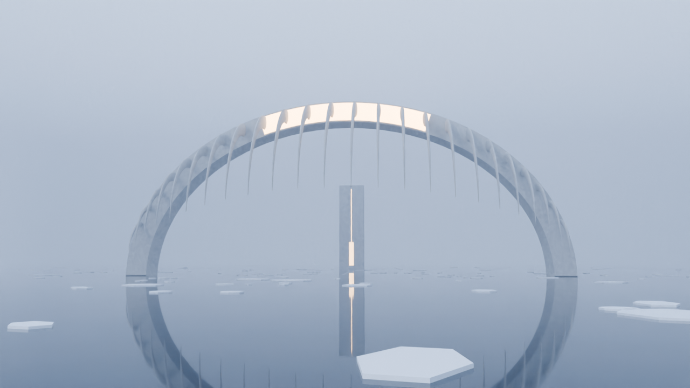
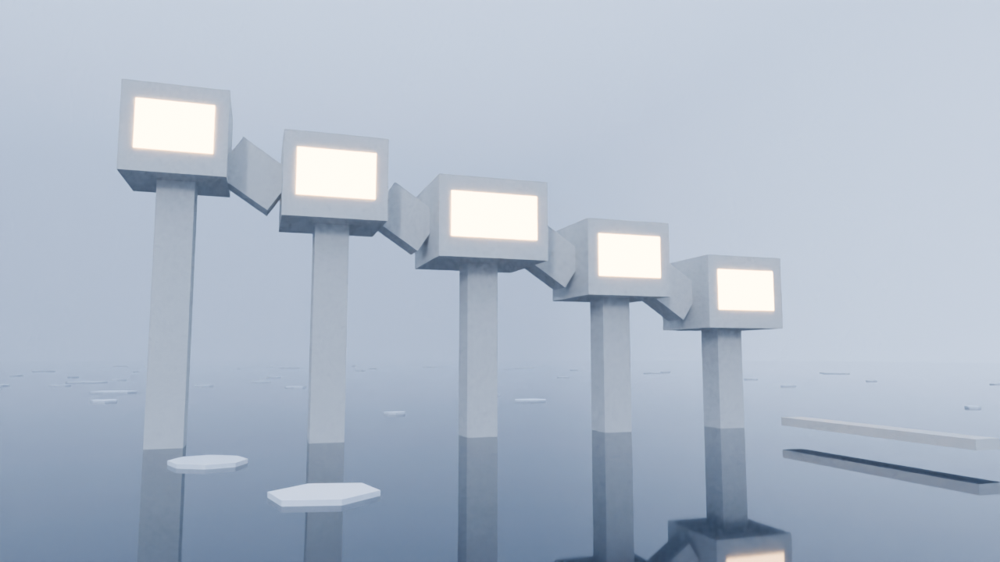
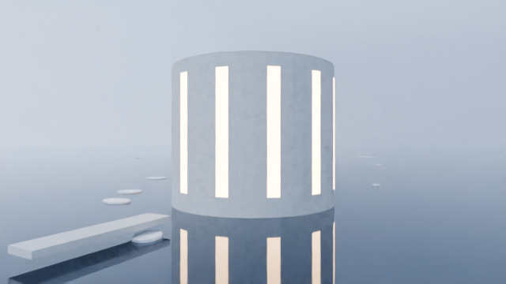
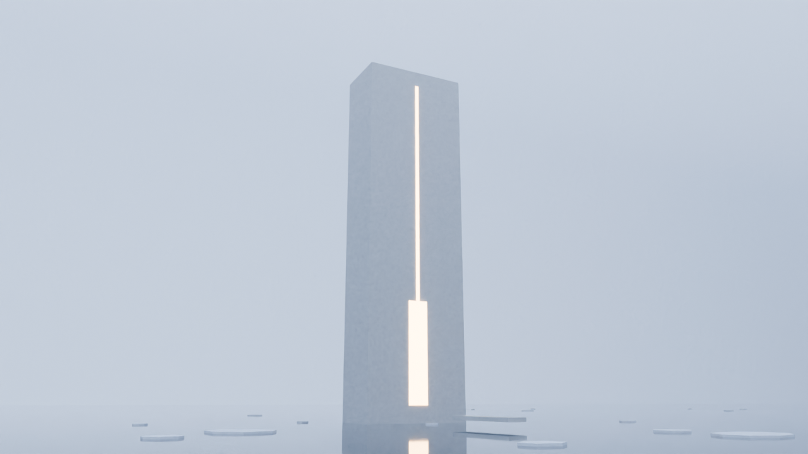

# Ribcage: Homes on the Ice

A Roblox life sim set in four brutalist concrete homes on a frozen, foggy sea,
starting with the "ribcage" mansion from the reference video.

| The Vertebrae | The Well | The Monolith |
|---|---|---|
|  |  |  |

The game page title and description are in [`docs/GAME_PAGE.md`](docs/GAME_PAGE.md).

## Open it in Roblox Studio
1. Download `RibcageMansion.rbxlx` from this folder.
2. In Roblox Studio: **File > Open from File...** and pick `RibcageMansion.rbxlx`.
3. Press **Play**. Everything (the four homes, the sea, the ice, the furniture) is built
   by script when the game starts. It takes a few seconds.
   To see it without pressing Play, open **View > Command Bar** and run:
   `require(game.ServerScriptService.Modules.Builder).build()`
4. In **Lighting**, set **Technology** to **Future** for the warm interior lighting.
5. Saving progress needs a published place with **Game Settings > Security > Enable Studio
   Access to API Services** on.

## How to play
- **Start:** you arrive at the Ribcage dock. Ride the funicular in the glass booth up to the gallery.
- **Homes:** each home has a brass deed plinth. "Make this your home" and you'll wake up there.
  The deed also opens the concierge (upgrades and pets).
- **Travel:** ring the bell at any dock for the ferry, or take the boat (W/S throttle, A/D steer).
  At night (22:00 to 04:48 game time) the sea freezes, so you can walk between homes. It cracks at dawn.
- **Daily life:** cook at a stove, oven or coffee machine (a timing mini-game). The meal goes into your
  hands: click to eat, and sit down for a bonus. Wash the dishes, water the plants, make the bed,
  keep the fires fed and read by the fire. The "Today" list (T) tracks it.
- **Mystery:** ten notes from the architect are hidden across the four homes (J shows which home each is in).
  One gives the tuning of the ribs. Play it on the rib organ in the Ribcage's glass-floor lounge...
- **Keys:** J journal · T today's routine · P photo mode · R reel / stop the cooking marker · F second prompt.

## Where things are
| Home | Where | Inside |
|---|---|---|
| The Ribcage | centre | gallery with hanging fire, lap pool, glass floor, rib organ, galley, bedroom, rain bath; ladder to the roof |
| The Monolith | south | kitchen and dining, fire room with sunken pit, sleeping floor; steep ramps between floors |
| The Vertebrae | north-west | five cubes: entrance hall, kitchen, fire room, bedroom, bath with a glass lookout; lift from the dock |
| The Well | north-east | ground ring kitchen and dining, fire ring, sleeping ring; spiral ramp around a black pool |

## Optional Blender meshes
`blender/exports/` has Rib, Cat, Whale and Fireplace as `.fbx`. Import them in Studio
(**Avatar > Import 3D**) and put them in **ServerStorage > BlenderAssets** with those names;
the game uses them in place of the block-built versions. `blender/ribcage_assets.py`
regenerates them. `blender/ribcage_preview.py` builds all four homes in Blender and renders the
pictures in `docs/` (`-- --render`, add `--dawn` for the sunrise version).

## Editing the code
Scripts live in `roblox/src` (Rojo layout, `roblox/default.project.json`).
After changing them, rebuild the place with `python3 tools/build_place.py`.
Tuning (recipes, chores, pets, weather, notes, day length) is in
`roblox/src/ReplicatedStorage/Shared/Config.luau`.

| Module | What it does |
|---|---|
| `Builder` | builds everything in order |
| `World` | sea, lighting, the Ribcage island and dock, ice floes, the night ice sheet |
| `Mansion` | the Ribcage: spine, ribs, gallery rooms |
| `Homes/Monolith`, `Homes/Vertebrae`, `Homes/Well` | the other three homes |
| `Furnish` | shared furniture kit (kitchen, dining, fireplaces, bed, bath, deed, bell, notes) |
| `Registry` | everything usable, registered by every home |
| `Gameplay` | needs, cooking and eating, chores, fires, homes, travel, freeze, weather |
| `Food` | the meals as holdable 3D models |
| `Boats`, `Pets`, `Lore`, `Data` | boats, Mochi and adopted pets, the mystery, saving |
